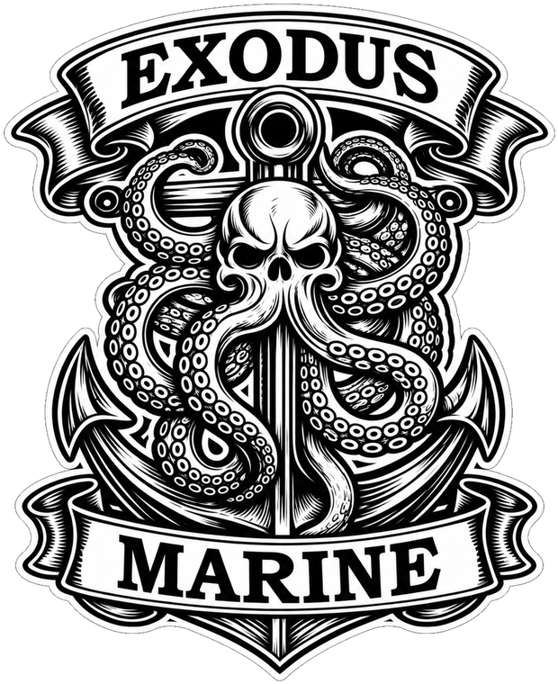

<p align="center"></p>

> **FREE ANCHOR ALARM APP: Android testers needed through the Play Store.**  
> Exodus Marine OS: anchor alarm, AIS alarm and boat dashboards on your phone. Two taps to join: **[sailingexodus.net/testers](https://sailingexodus.net/testers)**

# Exodus Radar

A full-screen radar display for a Raspberry Pi, drawing a **Raymarine Quantum** radar's own data stream, with AIS targets, an anchor watch, a wind gauge, depth and speed readouts and a rudder bar. It runs on the Pi that already runs OpenPlotter and Signal K aboard SV Exodus, on a plain HDMI screen at the nav station.

This is one boat's working setup, published as-is so you can run it on yours instead of rebuilding it. It is a second opinion, not the ship's radar; navigate on your chartplotter.


## What it does

- **Radar scope**: reads the Quantum's spoke multicast directly off the network, decodes it and paints a PPI at 8 frames a second. Range rings, bearing scale, head-up or north-up, trails, gain.
- **AIS targets** from Signal K, drawn on the scope with a 6-minute vector, and a *Dangerous AIS* list (CPA under 1000 ft within 15 minutes, or inside your near-miss ring).
- **Anchor watch**: tap WATCH ON and it drops a circle (default 150 ft) on the boat's position. Leave the circle and it sounds the alarm and sends a Telegram message. The watch is its own service, so it keeps watching if the window is closed.
- **Wind gauge** in the style of the chartplotter's: apparent (A) and true-over-ground (T) angles, apparent speed in the middle.
- **Readouts**: heading, SOG, STW, current (from STW vs SOG), depth, position. At anchor, depth and SOG go very large; underway they are a normal list.
- **Rudder bar** along the bottom.
- Click anywhere on the scope for range and bearing to that spot.

## What you need

- A **Raymarine Quantum** radar on the same Ethernet as the Pi. The scope reads the Quantum's own multicast spokes (`232.1.216.1:2574`), so this display is Quantum-specific. Other brands won't paint.
- A **Raspberry Pi** (a Pi 4 works, a Pi 5 is comfortable) with a screen, running **Signal K** for heading, position, wind, depth and AIS. OpenPlotter is the easy way to get there.
- **[mayara](https://github.com/MarineYachtRadar/mayara-server)** (Kees Verruijt) for radar *control*: transmit on/off and range changes go through its web GUI. The scope itself does not need mayara to paint.
- Python 3 with `numpy`, `Pillow` and `tkinter` (`sudo apt install python3-numpy python3-pil python3-pil.imagetk python3-tk`).
- A spare Ethernet address on the radar's network (the Quantum lives on `198.18.0.0/16`). `scripts/radar-net-setup` puts one on the Pi; `services/radar-net.service` keeps it there across reboots.

## Radar controls


**Power** is on the top bar, always visible: the button shows the radar's state (OFF / STANDBY / TRANSMIT) and a tap opens Transmit, Standby and Off. Transmit asks for a second tap within 4 seconds. If mayara cannot be reached it says RADAR: NO LINK.

Tap **MORE** (top bar). It opens two columns, docked at the right edge so the whole scope stays visible while you adjust: **Range** (quick-pick buttons from the radar's own range list, plus the display options) and **Radar settings**, the radar's own controls: power (Off / Standby / Transmit), gain, sea clutter, rain clutter,
interference rejection, mode and range. They are read from, and sent to, [mayara](https://github.com/MarineYachtRadar/mayara-server)
(address `http://127.0.0.1:6502`, change it with `"mayara_url"` in `~/.radar-display.json`). The panel is built from what your radar says
it supports, so it follows the model.

- **Full mayara panel.** The in-window Radar settings keep to what you tune most: power, gain, colour gain, sea, rain, mode and interference rejection. The last button opens mayara's own control page for the radar in a separate window, for everything else: guard zones, ARPA targets, trails, no-transmit sectors, bearing alignment.
- **Transmit asks twice.** The first tap on TRANSMIT turns it to PRESS AGAIN; the second tap sends it. Off and Standby act at once.
- **Range is the radar's range.** The range menu sets the radar's range, and the display follows whatever the radar is really set to, so the
  rings, AIS targets and the anchor circle stay to scale. If mayara cannot be reached the scope says *radar range not verified*: the rings
  may not match the echoes.
- **SCREEN GAIN** (under MORE) is only a brightness cut-off on the picture. It does not touch the radar. The radar's gain is in the Radar settings column.
- If mayara is not running, the MORE button turns amber and nothing is sent.

## Install

1. Copy the repo to the Pi, e.g. `/home/pi/exodus-radar`.
2. Put the Pi on the radar network. Pick **one** of two set-ups and do not mix them:
   - **A. Radar and Pi on the same Ethernet switch** (how the author's boat is wired): install `services/radar-net.service`, which adds a second address `198.18.9.200/16` to `eth0`. `services/mayara.service` also uses `eth0`. Nothing else is needed.
   - **B. A separate USB-Ethernet adapter used only for the radar** (advanced): run `sudo scripts/radar-net-setup` (read it first; it treats `eth0` as your boat LAN and picks another wired port), then change the interface name to match in `services/mayara.service`, `services/radar-net.service` and, if you use it, `IFACE` in `scripts/radar-net-guard`.
3. Install mayara and its service (`services/mayara.service`, edit the path to your mayara binary and the interface).
4. Install the anchor watch: `services/anchor-watch.service` (edit the path to `anchor-watch.py`). It writes `~/.anchor-watch-status.json` and reads `~/.anchor-watch.json`, which the display sets.
5. Edit the paths at the top of `radar-display.py` if your home directory isn't `/home/pi`: config file, anchor-watch files, the AIS alarm settings file and the title font (`assets/`). The Exodus mark is built into radar-display.py itself.
6. Run it: `scripts/radar-display.sh`. `scripts/Radar.desktop` is the desktop icon.

The display looks for Signal K at `http://127.0.0.1:3000`. Change `SK` in `radar-display.py` if your server is elsewhere.

By default it accepts the radar's multicast group from any source, so it works whatever address your radar was given. To filter on one radar, put `"radar_source": "<its IP>"` in `~/.radar-display.json` (for `radar-scope.py`, set the `RADAR_SOURCE` environment variable).

## Browser version (any phone, tablet or laptop on your boat network)

The same screen as a web page, so you do not need a monitor on the Pi: open it on a phone, a tablet or a laptop. Power, gain, sea, rain,
mode, interference and range are all on the page (open **MORE**), and so are the anchor watch, the AIS lists, the wind gauge and the rudder bar.

1. Do the **Install** steps above first (the Pi on the radar network, mayara running, Signal K for heading, wind, depth and AIS).
2. Put the repo on the Pi, copy `services/radar-web.service` to `/etc/systemd/system/` (edit the path to `radar-web-api.py` if it is not in `/home/pi/exodus-radar`), then
   `sudo systemctl daemon-reload && sudo systemctl enable --now radar-web`.
3. On any device on the same network open `http://<the Pi's address>:8480/`. Add `?view=1` for a **view-only** copy with no radar or anchor buttons (handy for a second screen).

Notes:

- `radar-web-api.py` serves the page and is the one narrow door for the radar controls (to mayara) and the anchor watch. It needs only Python 3. It expects Signal K on port 3000 and mayara on port 6502 of the same Pi; for mayara somewhere else, set `MAYARA_URL=http://host:6502` in the service. `RADAR_WEB_PORT` changes the port.
- **There is no login.** Anyone on your boat network can open the page and use the controls, exactly as with mayara's own page. Keep ports 8480 and 6502 on your boat network and never forward them to the internet. Over Tailscale or a similar VPN is fine.
- The service sends no cross-origin (CORS) headers, and every change (a radar setting or the anchor watch) must carry an `X-Radar-Web` header that other websites cannot send, so a web page you happen to visit cannot quietly change your radar.
- The picture comes from mayara's spoke stream, so the radar range and the colours are mayara's; the screen shows what mayara says the radar is set to.
- Tested in Chrome on a PC and on an Android phone and tablet. Chrome may show an orange "WebGPU not available" notice on mayara's own page when it is opened over plain http; this page does not use WebGPU.
- Swell works as on the desktop screen: nothing is drawn unless the anchor watch is ON and a fresh `~/.swell.json` exists.

## Optional pieces

- `radar-scope.py` is the raw-bytes view I built while decoding the Quantum stream. Handy for seeing what the radar is actually sending; not needed to run the display.
- `radar-capture.py` records the raw stream to a file for offline work.
- `scripts/radar-net-guard` keeps exactly one DHCP server on the radar network and stands down when an Axiom chartplotter appears. Only needed if you run the Pi *and* a Raymarine MFD on the same radar network.
- `scripts/radar-follow` restarts OpenCPN when the radar changes address, so OpenCPN's `radar_pi` can always command it.
- The anchor alarm can also send a Telegram message. It reads `~/.boat-telegram`, a plain text file with two lines:

  ```
  BOT_TOKEN=123456:your-bot-token
  ALLOWED_CHAT=your-chat-id
  ```

  Without that file it just sounds the alarm locally. **The message contains the boat's latitude and longitude and goes through Telegram's servers**, so use a private chat and keep the file readable only by the account that runs the service (`chmod 600`).

## Known limits

- Quantum only, as said. The spoke decoder is written to what a Quantum 2 sends; it has not been tested on a Quantum 1 or anything else.
- **Swell is experimental and off unless you feed it.** Nothing swell-related appears on the screen unless a fresh `~/.swell.json` exists, and it is only drawn while the anchor watch is ON (underway, a boat pitching into waves would read as swell). Format: `{"t": <unix time>, "hs_ft": 3.0, "period_s": 8, "from_true_deg": 45}`, refreshed at least every 10 minutes; `from_true_deg` is optional (without it you get the height and period but no direction bars). Nothing in this repo writes the file, and it is never faked. A boat-mounted IMU such as a BNO085 on the Pi can produce height and period, but treat it as an estimate: the sensor measures the boat's motion, not the sea, and one IMU does not give direction. To see what it looks like, with the watch ON: `echo '{"t": '$(date +%s)', "hs_ft": 2, "period_s": 6, "from_true_deg": 45}' > ~/.swell.json`.
- True wind is over the ground (no speed-through-water sensor on this boat), so at anchor A and T sit on top of each other.
- No ARPA/MARPA. Dangerous-target logic is AIS only.
- The CPU cost is real: about half a core on a Pi 5 while the window is open.

## Credits

- **Kees Verruijt** for [mayara](https://github.com/MarineYachtRadar/mayara-server) and [radar_pi](https://github.com/opencpn-radar-pi/radar_pi), and for `canboat`, which everything NMEA 2000 on this boat stands on. [Sponsor him](https://github.com/sponsors/keesverruijt).
- The [Signal K](https://signalk.org) and [OpenPlotter](https://openplotter.readthedocs.io) projects.
- Font: Pirata One (Google Fonts, SIL OFL 1.1).

## Support the boat

Optional, and nothing here is locked behind it. If this saved you some time and you want to say thanks:

- **[Ko-fi](https://ko-fi.com/sailingexodus)** for a one-off tip
- **[PayPal](https://paypal.me/marinefix)** for a one-off tip

The videos are on [YouTube](https://youtube.com/@sailing_exodus), the write-ups on [sailingexodus.net](https://sailingexodus.net), and the corrections go in the [Discord](https://discord.gg/TNd4ST8Jj4). We'd rather be corrected than confidently wrong.

Licensed under the [PolyForm Noncommercial License 1.0.0](LICENSE). Use it, change it and share it freely on your own boat or for any non-commercial purpose. If you'd like to use it in something you sell, or install it on other people's boats for a fee, just get in touch through https://sailingexodus.net and we'll work something out. Tell us what broke.

## Safety notice

**Exodus Radar is an independent, experimental project. It is not certified navigation or collision-avoidance equipment** and it is not
made, approved or endorsed by Raymarine or any other manufacturer.

It does not replace an approved radar or chartplotter, a proper lookout, charts or good seamanship. Radar echoes, AIS targets, range and
bearing, closest-point-of-approach predictions, wind and current estimates and anchor-watch alarms can be inaccurate, late, missing or
misleading. Not every vessel transmits AIS, and AIS data can be wrong or out of date, so never rely on it as the only basis for avoiding a
collision. The anchor watch is a supplemental alarm: it depends on GPS, power, the computer, the network and, for remote alerts, an outside
messaging service, and must not be your only way of noticing a dragging anchor. You are responsible for checking everything it shows you.

Use it entirely at your own risk. It is provided as-is, without warranty, under the terms of the license.

## Credits, trademarks and fonts

- Raymarine, Quantum, Garmin, Navico, B&G, Simrad and other product names are trademarks of their owners. They are used only to say what
  this works with. This project is not affiliated with, sponsored by or endorsed by any of them.
- The radar protocol was worked out from the data a Quantum puts on the network, with thanks to Kees Verruijt's mayara and radar_pi.
  No manufacturer firmware or proprietary code is included.
- The title font, Pirata One (Google Fonts), is under the SIL Open Font License 1.1; its text and copyright are in `assets/OFL.txt`. The font
  stays under that license, not this project's.
